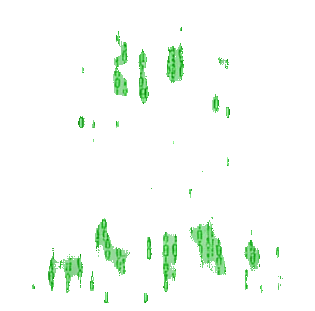

<div align="center">
  
  <h1>Ahmad Hassan</h1>
  <p><b>AI engineer &nbsp;·&nbsp; computational neuroscience researcher &nbsp;·&nbsp; music producer</b></p>
  <p><i>I build systems that reason in steps and read books that reason in centuries.</i></p>
  <a href="https://www.ahmadhassan.engineer/"></a>
  <a href="https://www.linkedin.com/in/ahmad-hassan3110"></a>
  <a href="mailto:ahmadhassan30nov@gmail.com"></a>
</div>

<br>

By day I build AI systems: agents that plan, remember, and argue with each other until they get it right. By night I'm somewhere between a neuroscience paper, a Dostoevsky novel and a beat that isn't finished yet.

It looks like four hobbies. It's one question.

<h3 align="center"><i>How does anything turn patterns into meaning?</i></h3>

A brain does it with neurons. A model does it with weights. A novel does it with foreshadowing. A song does it with tension and release. I go wherever that question shows up.

## A few things that are true

- I made two neural networks **argue** over skin-lesion images, and a third model **settle the argument**. &nbsp;→&nbsp; [ArgusVision](https://github.com/Ahmadhassan30/ArgusVision)
- I built a **C compiler framework in Rust**, designed so every transformation is traceable. &nbsp;→&nbsp; [Aether](https://github.com/Ahmadhassan30/Aether)
- I turn **lectures into animated explainers** without a single video-generation model. &nbsp;→&nbsp; [Anemo](https://github.com/Ahmadhassan30/Anemo)
- You can **sketch a website on paper**, snap a photo, and get working Next.js back. &nbsp;→&nbsp; [Morpheus](https://github.com/Ahmadhassan30/Morpheus)
- I **produce music**, and I built my own BPM, key and scale detector. &nbsp;→&nbsp; [Harmony](https://github.com/Ahmadhassan30/Harmony)
- I read Dostoevsky **as AI research**. The shelf below is not decoration.

## What I'm working on


**Computational neuroscience.** Computational models of the brain, and what they can teach machines.

**Resilient multi-agent reasoning.** Agents that coordinate under uncertainty, keep memory across long contexts, and change course when they're wrong.

**Emergent alignment.** The quiet preferences and biases instruction-tuned models pick up in training, the ones benchmarks miss.

**Retrieval past naive RAG.** Knowledge graphs fused with dense vectors and tool outputs, so a system can reason about what it retrieves.

<br clear="right">

## The shelf

<a href="https://ahmadhassan30.github.io/Ahmadhassan30/shelf/"></a>

Literature is compressed causal reasoning: plots that pay off three hundred pages later, narrators you can't trust, foreshadowing that works as prediction. That's exactly what reasoning systems struggle with, so I read it as research.

**[Open the shelf ↗](https://ahmadhassan30.github.io/Ahmadhassan30/shelf/)** It's a live three.js scene: hover a book to pull it out, click to open it. Or **[recommend me one](https://github.com/Ahmadhassan30/Ahmadhassan30/issues/new?title=Book%20recommendation%3A%20&body=Title%3A%0AAuthor%3A%0AWhy%20I%27d%20like%20it%3A%0A)**.

## In the studio


I make music. Producing is pattern work too: build tension, hold it, release it at exactly the right moment, and trust the listener to wait for the payoff.

It's also why [Harmony](https://github.com/Ahmadhassan30/Harmony) exists. Drop in any track and it tells you the BPM, key and scale, with several detection algorithms voting on the answer.

<br clear="left">

## Stack

<picture><source media="(prefers-color-scheme: dark)" srcset="https://skillicons.dev/icons?i=python,ts,rust,cpp,js,bash,pytorch,tensorflow,fastapi,django,nodejs,graphql&theme=dark"></picture>
<br>
<picture><source media="(prefers-color-scheme: dark)" srcset="https://skillicons.dev/icons?i=postgres,mongodb,redis,docker,kubernetes,aws,githubactions,nginx,react,nextjs,tailwind,linux&theme=dark"></picture>

## Activity

<!-- activity:start -->
```text
contributions by month

dec 25   ████▊                                  35
jan 26   ██████▏                                45
feb 26   ███████████▌                           85
mar 26   ██████████████████████▌               166
apr 26   ██████████████████████████▊           197
may 26   ██████████▋                            78
jun 26   ██████████████▌                       107
jul 26   ████████████████████████████████████  265
aug 26   ████████████████▏                     119
sep 26   ████▏                                  30
oct 26   ████████▌                              63
nov 26   ██▌                                    18

1,246 in the last year · 114/365 days active · longest streak 6d · best day 60 (24 mar)
```
<!-- activity:end -->

<br>

<div align="center">
  <p><i>If you read this far, we'd probably get along.</i></p>
  <p><b><a href="https://github.com/Ahmadhassan30/Ahmadhassan30/issues/new?title=Book%20recommendation%3A%20&body=Title%3A%0AAuthor%3A%0AWhy%20I%27d%20like%20it%3A%0A">Recommend me a book</a></b> &nbsp;·&nbsp; <b><a href="mailto:ahmadhassan30nov@gmail.com">Say hi</a></b></p>
  <br>
  <p><i>“The question of whether a computer can think is no more interesting than the question of whether a submarine can swim.”</i><br>Edsger W. Dijkstra</p>
</div>
