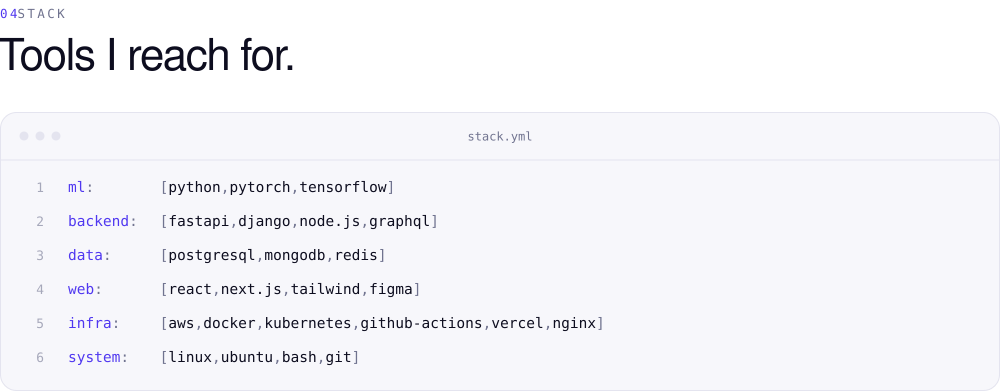

<a href="https://www.ahmadhassan.engineer/">
  <picture>
    <source media="(prefers-color-scheme: dark)" srcset="assets/hero-dark.svg">
    
  </picture>
</a>

 

I work where autonomous agents, retrieval and knowledge representation meet. I don't stay in one layer of the stack, because the problems I care about don't live in one. Most days that means turning model hallucinations into features people can rely on.

 

<picture>
  <source media="(prefers-color-scheme: dark)" srcset="assets/work-dark.svg">
  
</picture>

  

<picture>
  <source media="(prefers-color-scheme: dark)" srcset="assets/research-dark.svg">
  
</picture>

**Resilient multi-agent reasoning.** Agents that coordinate under uncertainty, keep memory across long contexts, and change strategy when they notice they are wrong.

**Emergent alignment in instruction-tuned models.** The implicit preferences and biases that training produces and standard benchmarks miss.

**Retrieval past naive RAG.** Knowledge graphs fused with dense vectors and tool outputs, so a pipeline can reason about what it retrieves instead of matching on surface similarity.

 

<a href="https://github.com/Ahmadhassan30/Ahmadhassan30/issues/new?title=Book%20recommendation%3A%20&body=Title%3A%0AAuthor%3A%0AWhy%20I%27d%20like%20it%3A%0A">
  <picture>
    <source media="(prefers-color-scheme: dark)" srcset="assets/shelf-dark.svg">
    
  </picture>
</a>

I read as many books as I can, as method rather than decoration. Stories carry the patterns multi-step reasoning struggles with: dependencies that span hundreds of pages, narrators you shouldn't trust, foreshadowing that works as prediction. So I build embeddings from book-level thematic analysis, and work toward agents that keep an internal story world while they act in an external one.

 

<picture>
  <source media="(prefers-color-scheme: dark)" srcset="assets/stack-dark.svg">
  
</picture>

  

<picture>
  <source media="(prefers-color-scheme: dark)" srcset="assets/activity-dark.svg">
  
</picture>

   

<picture>
  <source media="(prefers-color-scheme: dark)" srcset="assets/footer-dark.svg">
  
</picture>

 

  <a href="https://www.ahmadhassan.engineer/"><picture><source media="(prefers-color-scheme: dark)" srcset="assets/link-site-dark.svg"></picture></a>
  <a href="https://www.linkedin.com/in/ahmad-hassan3110"><picture><source media="(prefers-color-scheme: dark)" srcset="assets/link-linkedin-dark.svg"></picture></a>
  <a href="mailto:ahmadhassan30nov@gmail.com"><picture><source media="(prefers-color-scheme: dark)" srcset="assets/link-email-dark.svg"></picture></a>

