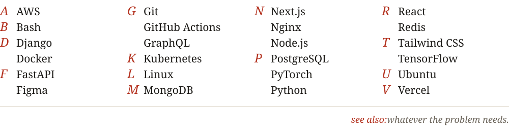
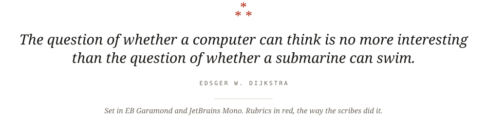

<a href="https://www.ahmadhassan.engineer/">
  <picture>
    <source media="(prefers-color-scheme: dark)" srcset="assets/hero-dark.svg">
    
  </picture>
</a>

 

I work where autonomous agents, retrieval and knowledge representation meet. I don't stay in one layer of the stack, because the problems I care about don't live in one. Most days that means turning model hallucinations into features people can rely on. Some days it means making the buttons pretty.

 

<picture>
  <source media="(prefers-color-scheme: dark)" srcset="assets/chapter-1-dark.svg">
  
</picture>

<picture>
  <source media="(prefers-color-scheme: dark)" srcset="assets/build-dark.svg">
  
</picture>

  

<picture>
  <source media="(prefers-color-scheme: dark)" srcset="assets/chapter-2-dark.svg">
  
</picture>

**§ 1 &nbsp; Resilient multi-agent reasoning.** Agents that coordinate under uncertainty, keep memory across long contexts, and change strategy when they notice they are wrong. Executing a task is the easy part; I care about agents that understand what they are doing and adapt when it goes sideways.

**§ 2 &nbsp; Emergent alignment in instruction-tuned models.** The implicit preferences and systemic biases that training produces and standard benchmarks miss. A system can be capable without being aligned, and I want to know exactly where those two come apart.

**§ 3 &nbsp; Retrieval past naive RAG.** Knowledge graphs fused with dense vector search and structured tool outputs: the precision of a graph, the recall of embeddings, and a pipeline that reasons about what it pulls back instead of matching on surface similarity.

 

<picture>
  <source media="(prefers-color-scheme: dark)" srcset="assets/chapter-3-dark.svg">
  
</picture>

> *Where symbolic pattern meets human metaphor, intelligence becomes narrative.*

I read as many books as I can, and not as decoration. Stories carry exactly the patterns multi-step reasoning systems struggle to learn: dependencies that span hundreds of pages, narrators you shouldn't trust, foreshadowing that works as a prediction, motifs that behave like latent clusters. Dostoevsky, Kafka, Tolstoy, Nietzsche and Plath were building internally consistent world models and running simulations inside them. Our best models are only starting to do the same.

So I test the idea. I build embeddings from book-level thematic analysis to see how models cluster abstract concepts, line up narrative devices against attention patterns, and work toward agents that keep an internal story world while they act in an external one.

 

<picture>
  <source media="(prefers-color-scheme: dark)" srcset="assets/translation-dark.svg">
  
</picture>

  

<picture>
  <source media="(prefers-color-scheme: dark)" srcset="assets/shelf-dark.svg">
  
</picture>

  

<picture>
  <source media="(prefers-color-scheme: dark)" srcset="assets/chapter-4-dark.svg">
  
</picture>

<picture>
  <source media="(prefers-color-scheme: dark)" srcset="assets/index-dark.svg">
  
</picture>

  

<picture>
  <source media="(prefers-color-scheme: dark)" srcset="assets/appendix-dark.svg">
  
</picture>

<picture>
  <source media="(prefers-color-scheme: dark)" srcset="assets/activity-dark.svg">
  
</picture>

  

<picture>
  <source media="(prefers-color-scheme: dark)" srcset="assets/colophon-dark.svg">
  
</picture>

  <a href="https://www.ahmadhassan.engineer/"><picture><source media="(prefers-color-scheme: dark)" srcset="assets/link-site-dark.svg"></picture></a>
  <a href="https://www.linkedin.com/in/ahmad-hassan3110"><picture><source media="(prefers-color-scheme: dark)" srcset="assets/link-linkedin-dark.svg"></picture></a>
  <a href="mailto:ahmadhassan30nov@gmail.com"><picture><source media="(prefers-color-scheme: dark)" srcset="assets/link-email-dark.svg"></picture></a>

