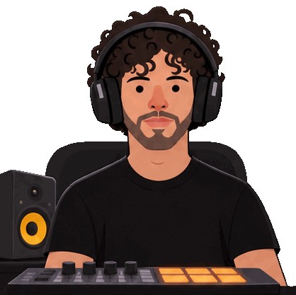
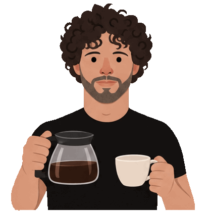
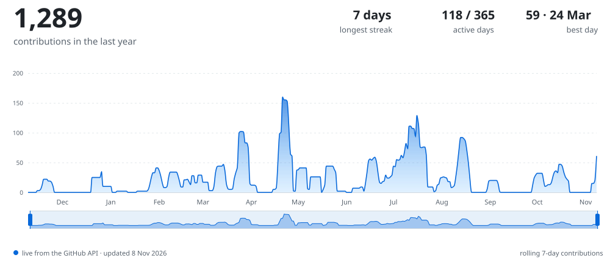

<picture>
  <source media="(prefers-color-scheme: dark)" srcset="assets/hero-dark.svg">
  
</picture>

## Hey, I'm Ahmad

**AI engineer · computational neuroscience researcher · music producer**

I build systems that reason in steps and read books that reason in centuries.

- Researching **computational neuroscience**, and what brains can teach machines
- Building **multi-agent systems** and **retrieval pipelines** that hold up in production
- Producing **music**, and I wrote my own BPM, key and scale detector for it
- Reading **Dostoevsky, Kafka and Tolstoy** like they're research papers
- Ask me about agents, RAG, or the last book I finished

&nbsp;&nbsp;

&nbsp;&nbsp;

> It looks like four hobbies. It's one question: **how does anything turn patterns into meaning?**
> A brain does it with neurons, a model with weights, a novel with foreshadowing, a song with tension and release.

## Things I've built

**[ArgusVision](https://github.com/Ahmadhassan30/ArgusVision)** &nbsp;·&nbsp; Two neural networks argue over a skin-lesion image, and a third model settles the argument. Uncertainty-aware medical AI. 
`PyTorch` `FastAPI` `Next.js` `LightGBM`

**[Aether](https://github.com/Ahmadhassan30/Aether)** &nbsp;·&nbsp; A C compiler framework in Rust, built so every transformation between program representations is traceable. 
`Rust`

**[Anemo](https://github.com/Ahmadhassan30/Anemo)** &nbsp;·&nbsp; Turns a lecture into an animated explainer, deterministically, without a single video-generation model. 
`Python` `TypeScript` `agents`

**[Morpheus](https://github.com/Ahmadhassan30/Morpheus)** &nbsp;·&nbsp; Sketch a website on paper, snap a photo, get working Next.js + Tailwind back. 
`TypeScript` `LangChain` `RAG` `vision LLM`

**[Harmony](https://github.com/Ahmadhassan30/Harmony)** &nbsp;·&nbsp; Drop in any track and get its BPM, key and scale, with several detection algorithms voting on the answer. 
`Python` `TypeScript` `audio`

## Research interests

- **Computational neuroscience:** computational models of the brain, and what they can teach machines
- **Resilient multi-agent reasoning:** coordination under uncertainty, long-context memory, changing course when wrong
- **Emergent alignment:** the quiet preferences and biases instruction-tuned models pick up that benchmarks miss
- **Retrieval past naive RAG:** knowledge graphs + dense vectors + tool outputs, so retrieval can reason
- **Literature as reasoning:** stories are compressed causal reasoning, so I read them as research &nbsp;→&nbsp; [recommend me a book](https://github.com/Ahmadhassan30/Ahmadhassan30/issues/new?title=Book%20recommendation%3A%20&body=Title%3A%0AAuthor%3A%0AWhy%20I%27d%20like%20it%3A%0A)

## What I love to do

  
  
  
  

**Making music.** Producing is pattern work too: build tension, hold it, and release it at exactly the right moment. It's also why [Harmony](https://github.com/Ahmadhassan30/Harmony) exists.

**Reading.** Dostoevsky, Camus, Kafka, Plato, Nietzsche. Old novels and philosophy are where I take the questions code can't answer.

**Coffee.** The fuel behind most of the code above, and most of the reading too.

**Research.** Sketching models of how brains compute, then testing whether machines can learn the same tricks.

## Tech stack

**Languages**

  
  &nbsp;
  
  &nbsp;
  <picture><source media="(prefers-color-scheme: dark)" srcset="https://cdn.simpleicons.org/rust/white"></picture>
  &nbsp;
  
  &nbsp;
  
  &nbsp;
  

**AI & machine learning**

  
  &nbsp;
  
  &nbsp;
  
  &nbsp;
  
  &nbsp;
  <picture><source media="(prefers-color-scheme: dark)" srcset="https://cdn.simpleicons.org/langchain/white"></picture>

**GPU & inference engineering**

  
  &nbsp;
  
  &nbsp;
  

Kernels, serving and optimisation: <code>CUDA</code> <code>cuDNN</code> <code>TensorRT</code> <code>Triton Inference Server</code> <code>llama.cpp</code> <code>Ollama</code>

**Computational neuroscience**

  
  &nbsp;
  
  &nbsp;
  <picture><source media="(prefers-color-scheme: dark)" srcset="https://cdn.simpleicons.org/pandas/white"></picture>
  &nbsp;
  
  &nbsp;
  
  &nbsp;
  
  &nbsp;
  
  &nbsp;
  

Modelling and analysis: <code>Brian2</code> <code>NEST</code> <code>NEURON</code> <code>MNE-Python</code> <code>Nilearn</code>

**Backend & infrastructure**

  
  &nbsp;
  <picture><source media="(prefers-color-scheme: dark)" srcset="https://cdn.simpleicons.org/django/white"></picture>
  &nbsp;
  
  &nbsp;
  
  &nbsp;
  
  &nbsp;
  
  &nbsp;
  
  &nbsp;
  
  &nbsp;
  
  &nbsp;
  
  &nbsp;
  
  &nbsp;
  
  &nbsp;
  

**Frontend**

  
  &nbsp;
  <picture><source media="(prefers-color-scheme: dark)" srcset="https://cdn.simpleicons.org/nextdotjs/white"></picture>
  &nbsp;
  

## GitHub activity

<picture>
  <source media="(prefers-color-scheme: dark)" srcset="assets/activity-dark.svg">
  
</picture>

 

  
<i>“The question of whether a computer can think is no more interesting than the question of whether a submarine can swim.”</i> Edsger W. Dijkstra

  
<b><a href="https://github.com/Ahmadhassan30/Ahmadhassan30/issues/new?title=Book%20recommendation%3A%20&body=Title%3A%0AAuthor%3A%0AWhy%20I%27d%20like%20it%3A%0A">Recommend me a book</a></b> &nbsp;·&nbsp; <b><a href="mailto:ahmadhassan30nov@gmail.com">Say hi</a></b>

