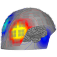
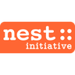

<picture>
  <source media="(prefers-color-scheme: dark)" srcset="assets/hero-dark.svg">
  
</picture>

## GitHub activity

<picture>
  <source media="(prefers-color-scheme: dark)" srcset="assets/activity-dark.svg">
  
</picture>

## Tech stack

  <b>Languages</b>
    
  
  
  <picture><source media="(prefers-color-scheme: dark)" srcset="https://cdn.simpleicons.org/rust/white"></picture>
  
  
  

  <b>AI & ML</b>
    
  
  
  
  
  <picture><source media="(prefers-color-scheme: dark)" srcset="https://cdn.simpleicons.org/langchain/white"></picture>

  <b>GPU & inference</b>
    
  
  
  
   
  <code>cuDNN</code> <code>TensorRT</code> <code>Triton Inference Server</code> <code>llama.cpp</code> <code>Ollama</code>

  <b>Computational neuroscience</b>
    
  
  
  
  
  
  
   
  
  
  <picture><source media="(prefers-color-scheme: dark)" srcset="https://cdn.simpleicons.org/pandas/white"></picture>
  
  
  
  
  
   
  <code>NEURON</code> <code>PyNN</code> <code>Elephant</code> <code>NWB</code>

  <b>Backend & data</b>
    
  
  <picture><source media="(prefers-color-scheme: dark)" srcset="https://cdn.simpleicons.org/django/white"></picture>
  
  
  
  
  

  <b>Infrastructure</b>
    
  
  
  
  
  
  

  <b>Frontend</b>
    
  
  <picture><source media="(prefers-color-scheme: dark)" srcset="https://cdn.simpleicons.org/nextdotjs/white"></picture>
  

## Things I've built

**[ArgusVision](https://github.com/Ahmadhassan30/ArgusVision)** &nbsp;·&nbsp; Two neural networks argue over a skin-lesion image, and a third model settles the argument. Uncertainty-aware medical AI. 
`PyTorch` `FastAPI` `Next.js` `LightGBM`

**[Aether](https://github.com/Ahmadhassan30/Aether)** &nbsp;·&nbsp; A C compiler framework in Rust, built so every transformation between program representations is traceable. 
`Rust`

**[Anemo](https://github.com/Ahmadhassan30/Anemo)** &nbsp;·&nbsp; Turns a lecture into an animated explainer, deterministically, without a single video-generation model. 
`Python` `TypeScript` `agents`

**[Morpheus](https://github.com/Ahmadhassan30/Morpheus)** &nbsp;·&nbsp; Sketch a website on paper, snap a photo, get working Next.js + Tailwind back. 
`TypeScript` `LangChain` `RAG` `vision LLM`

**[Harmony](https://github.com/Ahmadhassan30/Harmony)** &nbsp;·&nbsp; Drop in any track and get its BPM, key and scale, with several detection algorithms voting on the answer. 
`Python` `TypeScript` `audio`

## Research interests

- **Computational neuroscience:** computational models of the brain, and what they can teach machines
- **Resilient multi-agent reasoning:** coordination under uncertainty, long-context memory, changing course when wrong
- **Emergent alignment:** the quiet preferences and biases instruction-tuned models pick up that benchmarks miss
- **Retrieval past naive RAG:** knowledge graphs + dense vectors + tool outputs, so retrieval can reason
- **Literature as reasoning:** stories are compressed causal reasoning, so I read them as research &nbsp;→&nbsp; [recommend me a book](https://github.com/Ahmadhassan30/Ahmadhassan30/issues/new?title=Book%20recommendation%3A%20&body=Title%3A%0AAuthor%3A%0AWhy%20I%27d%20like%20it%3A%0A)

## What I love to do

<table>
  <tr>
    <td align="center" valign="top" width="25%">
       
      <b>Making music</b> 
      Pattern work in sound: build tension, hold it, release it on the beat.
    </td>
    <td align="center" valign="top" width="25%">
       
      <b>Reading</b> 
      Dostoevsky, Kafka, Camus, Plato. For the questions code can't answer.
    </td>
    <td align="center" valign="top" width="25%">
       
      <b>Coffee</b> 
      The fuel behind most of the code, and most of the reading.
    </td>
    <td align="center" valign="top" width="25%">
       
      <b>Research</b> 
      How brains compute, and whether machines can learn it too.
    </td>
  </tr>
</table>

 

  
<i>“The question of whether a computer can think is no more interesting than the question of whether a submarine can swim.”</i> Edsger W. Dijkstra

  
<b><a href="https://github.com/Ahmadhassan30/Ahmadhassan30/issues/new?title=Book%20recommendation%3A%20&body=Title%3A%0AAuthor%3A%0AWhy%20I%27d%20like%20it%3A%0A">Recommend me a book</a></b> &nbsp;·&nbsp; <b><a href="mailto:ahmadhassan30nov@gmail.com">Say hi</a></b>

